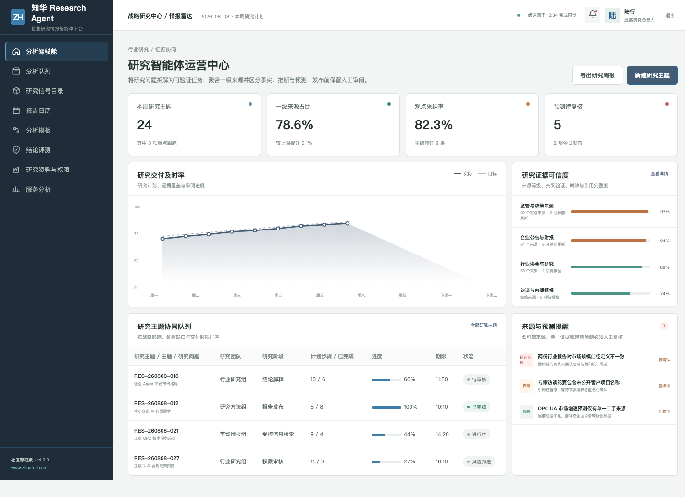
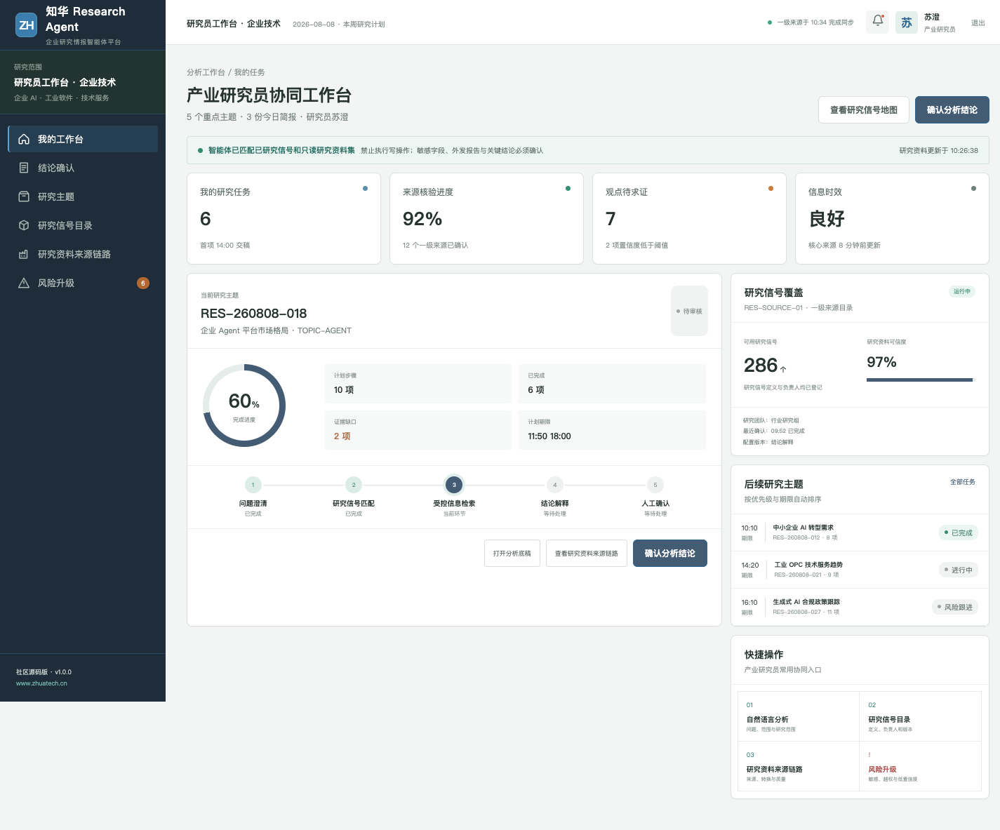

# ResearchAgent — 知华科技企业研究情报智能体

2026-10-23 功能更新：**研究结论引用台账检查**。校验结论引用编号、来源重复和证据摘录是否为空，返回孤立结论及未使用来源。只核对所提交的证据台账，不访问网络或宣称结论真实。 [接口、操作与边界说明](docs/AI_PRACTICAL_UPGRADE_20261023.md)。

[简体中文](README.md) | [English](README.en.md)

> Evidence first. 先验证来源，再形成观点。

ResearchAgent 是[上海如静知华信息科技有限公司（知华科技）](https://www.zhuatech.cn/)发布的企业研究情报社区源码项目，适用于战略研究、市场情报、技术雷达和专题分析场景。

它关注的不是“生成一篇看起来完整的报告”，而是把研究拆题、来源分级、事实核验、推断标记、观点审阅和引用追溯做成清晰流程。

## 本次升级：研究来源独立性与一手证据比例

核对独立来源族、一手来源、失效链接及最低独立证据数量，防止把转载数量当作独立佐证。只处理调用方已归类的统计。

新增已认证的结构化录入工作台（`/operations.html`），支持批量核算、逐条结果依据、分级复核和CSV/完整JSON导出。结果由真实后端算法计算，不是预置演示数字。所有数值精确传递，不调用外部模型。

这是**只读核算**：不写库、不审批、不自动执行财务、签署、销毁或设备控制。输入条件满足不是执行授权。[算法、输入边界与接口说明](docs/OPERATIONS-REVIEW.md)。
## 两个工作界面

研究运营中心从主题组合、证据缺口、交付时间和预测风险观察整个研究管线。

研究员工作台展示当前问题、一级来源、交叉验证状态、观点草稿和待审内容，方便人机协同完成研究，而不是把判断外包给模型。

## 研究方法内置于产品

1. 把主题拆成可以验证的子问题。
2. 优先引用监管文件、企业公告、标准和原始研究。
3. 标注发布日期、适用地区与信息时效。
4. 明确区分事实、推断、假设和预测。
5. 对单一来源、冲突来源和低置信结论发起复核。
6. 发布前由研究负责人审阅观点与适用边界。

`ResearchEvidenceService` 根据来源数量、一级来源占比和是否包含预测计算证据置信度，输出 `EVIDENCE_GAP`、`SOURCE_REVIEW`、`FORECAST_REVIEW` 或 `DRAFT_READY`。

## 可运行工程

后端采用 Java 21、Spring Boot、Spring Security、JWT、JPA、MySQL 8 与 Flyway；前端采用 Vue 3、Pinia、Vue Router、Axios 与 Vite。仓库同时提供 H2 测试、Docker Compose、Nginx、CI、API、架构、数据库和部署文档。

~~~bash
cd frontend
npm install
npm run dev:demo
~~~

访问 `http://localhost:5173`。研究管理端为 `planner / Demo@2026`，研究员端为 `operator / Demo@2026`。默认演示数据不代表真实市场结论，系统不会自动浏览互联网或调用真实模型。

## License / 商业授权

代码**仅供个人学习、研究和非商业交流，不得商用**。生产部署、企业内部使用、商业交付、SaaS、收费服务、二次销售或品牌替换须事先获得上海如静知华信息科技有限公司书面授权，完整条款见 [LICENSE](LICENSE)。

企业研究 Agent 定制、私有知识源接入、AI 转型咨询与软件项目外包，请访问[知华科技官网](https://www.zhuatech.cn/)或扫码咨询。

| 技术与方案 | 商务与交付 |
| --- | --- |
|  |  |

SEO：Research Agent、行业研究智能体、市场情报系统、技术雷达、可追溯引用、企业 AI、知华科技。

## 输入对照与版本化快照

在既有「研究来源独立性与一手证据比例」基础上，新增 `/comparison.html`：基准与候选两组数据都由当前真实算法重算，按编号展示新增、移除、逐字段变化和精确数值差，支持筛选、分页和全量导出。原核算入口可导出输入快照，对照页经后端完整校验后整体导入；失败不覆盖当前输入。

快照区分项目、字段契约及算法版本。建议较宽松不代表风险已下降，输入摘要不是签名；操作人和时间仅为响应元数据，不是持久化审计。本次未新增模型调用或业务写入，也不代表全系统生产认证。详见[输入对照操作与接口说明](docs/INPUT-COMPARISON.md)。
